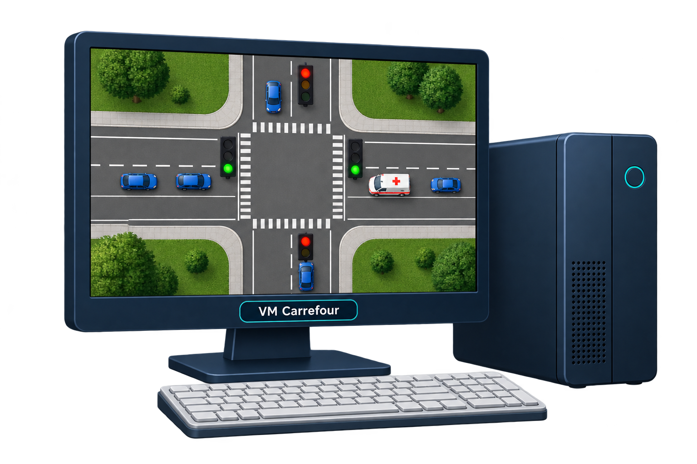
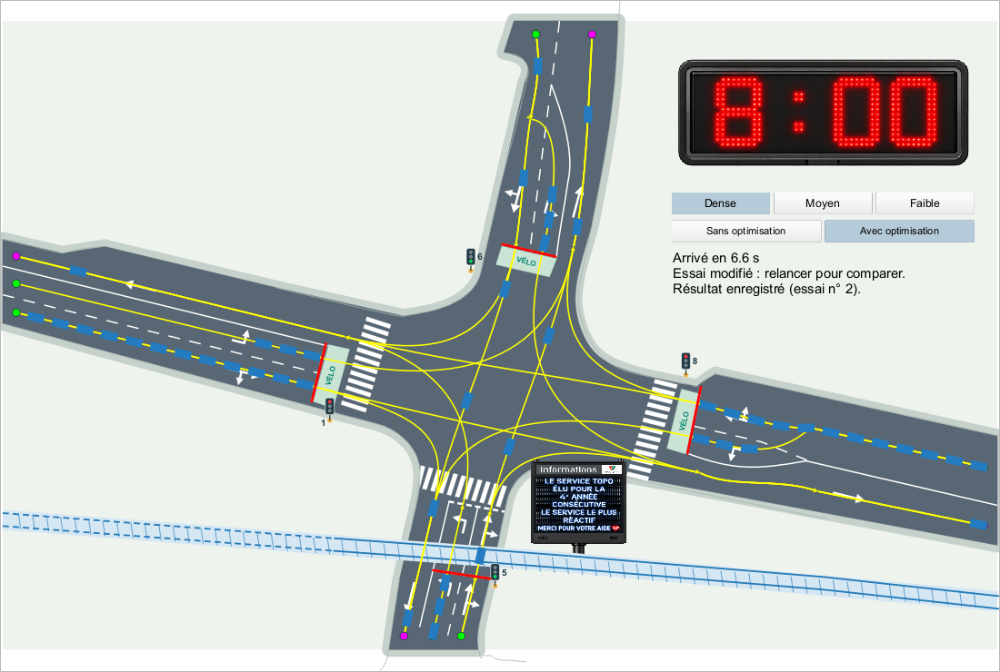
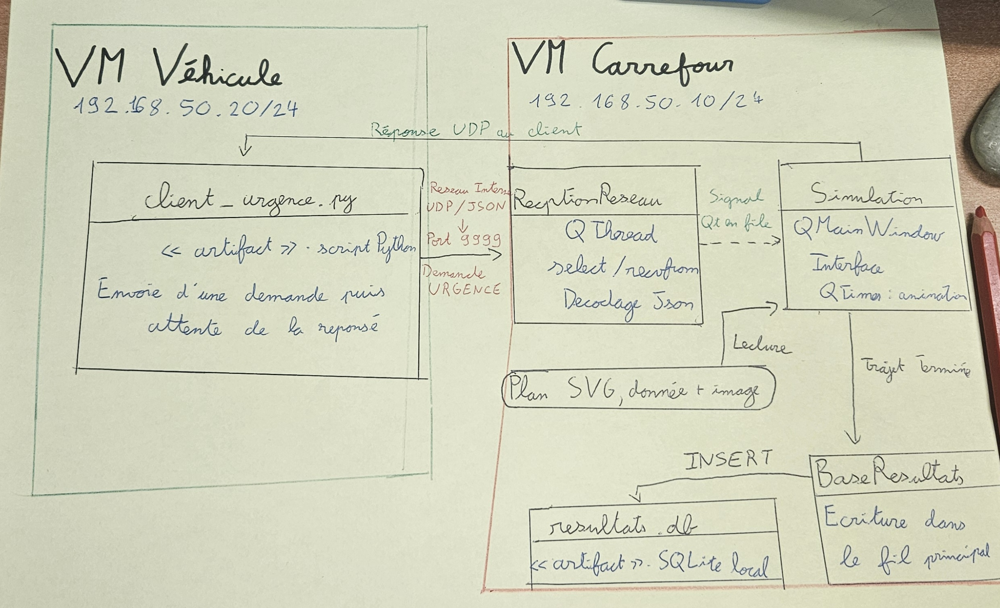

<div align="center">

# Simulateur de carrefour connecté

**SAÉ 3.02 · Commit & Push**  
**Basile JUNG · Martin LE LANNO**

Une maquette du carrefour **Poudrière / Riquewihr / Ingersheim, à Colmar**, pour étudier le passage d’un véhicule d’urgence avec et sans optimisation.

**Python 3 · PySide6 · SQLite · UDP / JSON · Debian 13**

[Installer le projet](installation/README.md) · [Télécharger les ZIP](#téléchargements) · [Consulter les UML](#nos-diagrammes-uml)

 

</div>

## Deux VM pour une démonstration

La **VM Carrefour** affiche le trafic, reçoit les demandes d’urgence et enregistre les temps de parcours. La **VM Véhicule** envoie la demande depuis un client Python indépendant.

1. Ouvrir la simulation sur Carrefour et choisir le trafic ainsi que le mode.
2. Lancer le client sur Véhicule et saisir l’IP interne de Carrefour.
3. Observer le passage de l’ambulance, puis consulter le résultat enregistré dans SQLite.

Le changement de mode ne déclenche pas d’ambulance. L’urgence est demandée uniquement depuis le client. Le port UDP est fixé à **9999**.

<details>
<summary><strong>Voir un aperçu de la simulation</strong></summary>



</details>

## Téléchargements

| Ressource | Contenu | Accès |
|---|---|---|
| **ZIP Carrefour** | Simulation, plan SVG, images, trajectoires SQLite et dépendances | [Télécharger](https://github.com/mlelanno/SAE-R3.02/raw/main/ZIP/VM_Carrefour.zip) |
| **ZIP Véhicule**  | Client d’urgence Python                                           | [Télécharger](https://github.com/mlelanno/SAE-R3.02/raw/main/ZIP/VM_Vehicule.zip)  |
| **Notice GIT HUB** | Réseau, installation et lancement des deux VM | [Lire la notice](installation/README.md) |
| **Fiche PDF** | Support d’installation PDF | [Ouvrir le PDF](installation/Fiche_installation.pdf) |

Les OVA restent hébergés sur Google Drive et ne sont pas inclus dans ce dépôt. La fiche PDF est le support prévu pour leurs liens de téléchargement. L’installation à partir des deux ZIP est disponible dès maintenant.

## Ce que fait la maquette

- Affichage du carrefour SVG et animation de **12 trajectoires**.
- Trois niveaux de circulation : **faible, moyen et dense**.
- Gestion des feux, des files et des véhicules qui tournent à gauche.
- Comparaison d’un passage d’urgence **avec ou sans optimisation**.
- Réception UDP dans un **QThread**, avec des signaux Qt pour transmettre les demandes à l’interface.
- Chargement des trajectoires depuis **carrefour.db** et sauvegarde des essais dans **resultats.db**.

La liaison réseau représente le **V2I**, entre le véhicule et le carrefour. Les réactions des autres voitures représentent le principe du **V2V dans la simulation** : chaque voiture ne possède pas son propre client réseau. Le passage des trains et le panneau d’information dynamique ne sont pas simulés.

## Nos diagrammes UML

### Diagramme de classes


[Ouvrir l’image en grand](UML/classes.png)

### Diagramme de déploiement



[Ouvrir l’image en grand](UML/deploiement.jpg)

Les adresses écrites sur le schéma sont des **exemples de configuration**. Le client demande l’IP interne réellement attribuée à Carrefour. La version livrée utilise également `carrefour.db` pour les trajectoires, en plus de la base des résultats représentée sur le dessin.

## Organisation du dépôt

```text
.
├── README.md                      Présentation du projet
├── requirements.txt               Version exacte de PySide6
├── ZIP/
│   ├── VM_Carrefour.zip            Archive à installer sur Carrefour
│   └── VM_Vehicule.zip             Archive à installer sur Véhicule
├── UML/
│   ├── classes.png                Notre diagramme de classes
│   └── deploiement.jpg            Notre diagramme de déploiement
├── installation/
│   ├── README.md                  Notice d’installation en ligne
│   └── Fiche_installation.pdf      Fiche illustrée
├── src/
│   ├── carrefour/                 Fichiers du ZIP Carrefour
│   └── vehicule/                  Fichier du ZIP Véhicule
└── docs/images/                   Illustrations et aperçu
```
